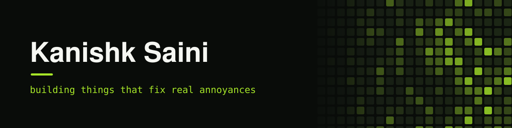

<div align="center">



<h3>First-year MBA Tech student &nbsp;|&nbsp; Learning to build &nbsp;|&nbsp; Sharing it as I go</h3>

<a href="https://kanishksaini-007.github.io/portfolio/"></a>
<a href="https://www.linkedin.com/in/itskanishksaini/"></a>
<a href="mailto:its.kanishk.saini@gmail.com"></a>

</div>

## About Me

```js
const kanishk = {
  location:    "Shirpur, India",
  education:   "MBA Tech @ NMIMS Shirpur (first year)",
  focus:       ["Small web apps", "Local-first tools", "Learning Flutter and C"],
  learning:    ["HTML", "CSS", "JavaScript", "Flutter", "C", "Git"],
  level:       "Beginner. Everything here is me learning by building.",
  currentlyOn: "Building small things and getting a bit better each day.",
  funFact:     "I am trying to keep my GitHub graph green every single day.",
};
```

I am new to all of this and I am learning by building small tools that fix an annoyance I actually have: attendance math, grade targets, splitting bills, staying focused. Everything runs in the browser, needs no login, and keeps your data on your own device. Some of it is rough, and I am improving it a little each day.

## Fun Stats

<table align="center">
<tr>
<td align="center"><b>14</b><br>apps live</td>
<td align="center"><b>17</b><br>public repos</td>
<td align="center"><b>250+</b><br>commits so far</td>
<td align="center"><b>Oct 2026</b><br>started building in public</td>
</tr>
</table>

## What I'm Learning

I am a beginner, so this is split by how far along I am. None of it is mastered yet.

**Learning by building every day**

   

**Just getting started (first steps)**

  

**Tools I am getting used to**

  

## GitHub Stats

| Stat | Now |
| --- | --- |
| Public repos | 17 |
| Live sites | 15 (14 apps + portfolio) |
| Commits | 250+ |
| Main languages | JavaScript, HTML, CSS, Dart |
| On GitHub since | October 2026 |

Numbers are checked and refreshed by hand as I ship.

## My Contribution Snake

<div align="center">
  <picture>
    <source media="(prefers-color-scheme: dark)" srcset="https://raw.githubusercontent.com/KanishkSaini-007/KanishkSaini-007/output/github-snake-dark.svg?v=2">
    <source media="(prefers-color-scheme: light)" srcset="https://raw.githubusercontent.com/KanishkSaini-007/KanishkSaini-007/output/github-snake.svg?v=2">
    
  </picture>
</div>

<p align="center"><sub>Auto-generated from my contribution graph every 12 hours. Each green square is something I built or fixed while learning.</sub></p>

## Featured Projects

<table>
<tr>
<td width="50%" valign="top">
<h3><a href="https://kanishksaini-007.github.io/AttendX/">AttendX</a></h3>
<p>Attendance planner. Set your required percentage, log classes and see how many you can skip or must attend.</p>
<p>  </p>
<p><a href="https://kanishksaini-007.github.io/AttendX/"><b>Live demo</b></a> &nbsp;|&nbsp; <a href="https://github.com/KanishkSaini-007/AttendX">View repo</a></p>
</td>
<td width="50%" valign="top">
<h3><a href="https://kanishksaini-007.github.io/QuickCV/">QuickCV</a></h3>
<p>Resume builder with live preview and clean print-to-PDF.</p>
<p> </p>
<p><a href="https://kanishksaini-007.github.io/QuickCV/"><b>Live demo</b></a> &nbsp;|&nbsp; <a href="https://github.com/KanishkSaini-007/QuickCV">View repo</a></p>
</td>
</tr>
<tr>
<td width="50%" valign="top">
<h3><a href="https://kanishksaini-007.github.io/FocusFlow/">FocusFlow</a></h3>
<p>Pomodoro timer with a session journal and weekly insights.</p>
<p>  </p>
<p><a href="https://kanishksaini-007.github.io/FocusFlow/"><b>Live demo</b></a> &nbsp;|&nbsp; <a href="https://github.com/KanishkSaini-007/FocusFlow">View repo</a></p>
</td>
<td width="50%" valign="top">
<h3><a href="https://kanishksaini-007.github.io/SplitSmart/">SplitSmart</a></h3>
<p>Expense splitter that works out the fewest payments to settle a group.</p>
<p> </p>
<p><a href="https://kanishksaini-007.github.io/SplitSmart/"><b>Live demo</b></a> &nbsp;|&nbsp; <a href="https://github.com/KanishkSaini-007/SplitSmart">View repo</a></p>
</td>
</tr>
<tr>
<td width="50%" valign="top">
<h3><a href="https://kanishksaini-007.github.io/GradeGoal/">GradeGoal</a></h3>
<p>Weighted-grade planner that shows the score you need on your final.</p>
<p> </p>
<p><a href="https://kanishksaini-007.github.io/GradeGoal/"><b>Live demo</b></a> &nbsp;|&nbsp; <a href="https://github.com/KanishkSaini-007/GradeGoal">View repo</a></p>
</td>
<td width="50%" valign="top">
<h3><a href="https://kanishksaini-007.github.io/TypeSpeed/">TypeSpeed</a></h3>
<p>Typing test with live WPM, accuracy and progress graphs.</p>
<p>  </p>
<p><a href="https://kanishksaini-007.github.io/TypeSpeed/"><b>Live demo</b></a> &nbsp;|&nbsp; <a href="https://github.com/KanishkSaini-007/TypeSpeed">View repo</a></p>
</td>
</tr>
<tr>
<td width="50%" valign="top">
<h3><a href="https://kanishksaini-007.github.io/HabitGrid/">HabitGrid</a></h3>
<p>Habit tracker with a yearly contribution grid, streaks and keyboard shortcuts.</p>
<p>  </p>
<p><a href="https://kanishksaini-007.github.io/HabitGrid/"><b>Live demo</b></a> &nbsp;|&nbsp; <a href="https://github.com/KanishkSaini-007/HabitGrid">View repo</a></p>
</td>
<td width="50%" valign="top">
<h3><a href="https://kanishksaini-007.github.io/Flutter_Application_01/">Flutter_Application_01</a></h3>
<p>My first Flutter app: a responsive glass-style profile page.</p>
<p> </p>
<p><a href="https://kanishksaini-007.github.io/Flutter_Application_01/"><b>Live demo</b></a> &nbsp;|&nbsp; <a href="https://github.com/KanishkSaini-007/Flutter_Application_01">View repo</a></p>
</td>
</tr>
<tr>
<td width="50%" valign="top">
<h3><a href="https://kanishksaini-007.github.io/portfolio/">Portfolio</a></h3>
<p>My 3D interactive portfolio site that pulls everything together.</p>
<p> </p>
<p><a href="https://kanishksaini-007.github.io/portfolio/"><b>Live demo</b></a> &nbsp;|&nbsp; <a href="https://github.com/KanishkSaini-007/portfolio">View repo</a></p>
</td>
<td width="50%" valign="top">
<h3><a href="https://kanishksaini-007.github.io/Corporate-Intelligence-Lab/">Corporate Intelligence Lab</a></h3>
<p>Financial ratio and distress analysis of 11 public companies from their 10-K filings, with an Altman Z-score and what-if stress tests.</p>
<p>  </p>
<p><a href="https://kanishksaini-007.github.io/Corporate-Intelligence-Lab/"><b>Live demo</b></a> &nbsp;|&nbsp; <a href="https://github.com/KanishkSaini-007/Corporate-Intelligence-Lab">View repo</a></p>
</td>
</tr>
<tr>
<td width="50%" valign="top">
<h3><a href="https://kanishksaini-007.github.io/DueSoon/">DueSoon</a></h3>
<p>Deadline tracker that shows what is due next, with a live countdown.</p>
<p>  </p>
<p><a href="https://kanishksaini-007.github.io/DueSoon/"><b>Live demo</b></a> &nbsp;|&nbsp; <a href="https://github.com/KanishkSaini-007/DueSoon">View repo</a></p>
</td>
<td width="50%" valign="top">
<h3><a href="https://kanishksaini-007.github.io/company-xray/">Company X-Ray</a></h3>
<p>Pick a listed company, see its share price and its products ranked weakest to strongest from real filings.</p>
<p> </p>
<p><a href="https://kanishksaini-007.github.io/company-xray/"><b>Live demo</b></a> &nbsp;|&nbsp; <a href="https://github.com/KanishkSaini-007/company-xray">View repo</a></p>
</td>
</tr>
<tr>
<td width="50%" valign="top">
<h3><a href="https://kanishksaini-007.github.io/Ask-Kanishk/">Ask Kanishk</a></h3>
<p>A small chatbot that answers questions about me and my projects. Talks to the Gemini API, with an offline fallback mode.</p>
<p>  </p>
<p><a href="https://kanishksaini-007.github.io/Ask-Kanishk/"><b>Live demo</b></a> &nbsp;|&nbsp; <a href="https://github.com/KanishkSaini-007/Ask-Kanishk">View repo</a></p>
</td>
<td width="50%" valign="top">
<h3><a href="https://kanishksaini-007.github.io/stark-sky/">Stark Sky</a></h3>
<p>A stylized New York City flight world: Manhattan, Central Park, rivers, bridges and 12 interactive project towers. A three.js learning project.</p>
<p> </p>
<p><a href="https://kanishksaini-007.github.io/stark-sky/"><b>Play it</b></a> &nbsp;|&nbsp; <a href="https://github.com/KanishkSaini-007/stark-sky">View repo</a></p>
</td>
</tr>
<tr>
<td width="50%" valign="top">
<h3><a href="https://kanishksaini-007.github.io/CGPAPlanner/">CGPA Planner</a></h3>
<p>Semester SGPA and CGPA planner with an editable grading scale and a target mode that works out the grades you need. Private, no login.</p>
<p>  </p>
<p><a href="https://kanishksaini-007.github.io/CGPAPlanner/"><b>Live demo</b></a> &nbsp;|&nbsp; <a href="https://github.com/KanishkSaini-007/CGPAPlanner">View repo</a></p>
</td>
<td width="50%" valign="top">
<h3><a href="https://kanishksaini-007.github.io/Nature-Inspired-Data-Storage/">Nature-Inspired Storage</a></h3>
<p>Two interactive labs: encode a message as DNA and recover it after copying errors, then evolve cargo plans with a genetic algorithm.</p>
<p> </p>
<p><a href="https://kanishksaini-007.github.io/Nature-Inspired-Data-Storage/"><b>Live demo</b></a> &nbsp;|&nbsp; <a href="https://github.com/KanishkSaini-007/Nature-Inspired-Data-Storage">View repo</a></p>
</td>
</tr>
</table>

## Connect With Me

<div align="center">

<a href="https://kanishksaini-007.github.io/portfolio/"></a>
<a href="https://www.linkedin.com/in/itskanishksaini/"></a>
<a href="mailto:its.kanishk.saini@gmail.com"></a>

Always happy to hear feedback or an idea for a small app. Drop a message anytime.

</div>
